# Colinas Cafés — Documento técnico da 1ª avaliação (ERP)

**Disciplina:** Sistemas de Informação e Tecnologias — Bacharelado em Ciência da Computação, UFAPE, 2026.2
**Professor:** Dr. Assuero Fonseca Ximenes
**Equipe:** _(preencher)_
**Aplicação publicada:** <https://colinas-cafes.streamlit.app/>
**Repositório:** <https://github.com/P3DROVFX/colinas-cafes-erp>

> As telas deste documento foram capturadas com o histórico de desenvolvimento gerado pelo *seed* (capítulo 9), de junho a novembro de 2026.

---

## 1. Descrição do sistema

### 1.1 A empresa

A **Colinas Cafés** é uma pequena empresa do Agreste de Pernambuco que **produz** café arábica em uma fazenda própria (Garanhuns/PE) e **compra** lotes de café verde de fazendas parceiras. Ela torra em pequenos lotes (microtorrefação, torrador de 15 kg por batelada), envasa em pacotes com válvula e vende **somente café torrado embalado** em três canais:

| Canal | Público | Características |
|---|---|---|
| **Loja** (local) | Consumidor no balcão | Retirada ou entrega na cidade; PIX, dinheiro e cartões |
| **Online** | Consumidor via site e redes | Envio em caixas por transportadora; PIX ou cartão de crédito |
| **Atacado** (B2B) | Cafeterias, restaurantes, empórios e empresas | Pedido mínimo, tabela de atacado, boleto a prazo com limite de crédito |

### 1.2 Problemas que o sistema resolve

Antes do sistema, estoque, torra, envase, pedidos e contas ficavam em planilhas isoladas. Isso causava:

- **divergência de estoque**: não se sabia quanto café verde, torrado ou embalado havia de fato;
- **custo real do pacote desconhecido**, porque a perda de massa na torra (quebra) não entrava no custo;
- **falta de rastreabilidade**: não se sabia de qual lote de torra saiu um pacote nem a data da torra (frescor);
- **ruptura de embalagens**: faltavam pacotes ou caixas e a produção parava;
- **falta de visibilidade financeira**: não se sabia o que vencia, o que estava atrasado, o saldo de caixa nem a margem por canal.

### 1.3 Objetivo

Simular, em escala reduzida e realista, o ciclo completo de um Sistema de Informação — **Operações → Dados → Decisão**. Esta entrega (VA1) é a camada operacional: um ERP com módulos integrados, login Google, persistência em PostgreSQL e publicação na web. A VA2 construirá o BI exclusivamente sobre os dados gerados aqui.

### 1.4 Escopo

**Dentro do escopo:** autenticação e papéis; cadastros (fazendas, fornecedores, cafés verdes, embalagens, produtos, clientes, categorias e contas financeiras); compras com recebimento, cancelamento, estorno e parcelamento; estoque com extrato, alertas, ajustes e localização; produção (colheita própria, torra e envase); vendas do orçamento à entrega, cancelamento e comprovante; financeiro (contas a pagar e a receber, despesas, liquidação, fluxo de caixa, conciliação e DRE); administração (usuários, parâmetros e painel de integridade).

**Fora do escopo (declarado):** emissão de NF-e/NFC-e (o comprovante é não fiscal); integração com gateway de pagamento, banco ou loja virtual; folha de pagamento e RH (salários entram como despesa); rastreabilidade por lote até a venda (vai até o lote de envase); devolução depois da expedição; multiempresa e transferência entre depósitos.

---

## 2. Processos de negócio

### 2.1 Cadeia de valor

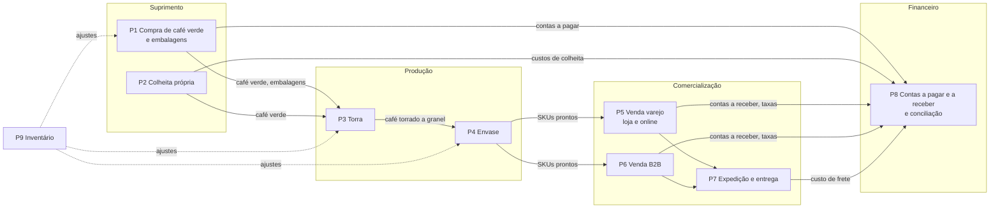

### 2.2 Processos

| Processo | Gatilho | Ator | Dados gerados | Módulos |
|---|---|---|---|---|
| **P1 Compra** | Estoque abaixo do mínimo ou safra disponível | Gerente | Pedido, itens, entradas de estoque, títulos a pagar | Compras, Estoque, Financeiro |
| **P2 Colheita própria** | Café beneficiado da fazenda chega ao armazém | Produção | Colheita, entrada de café verde com custo, título a pagar | Produção, Estoque, Financeiro |
| **P3 Torra** | SKU com estoque baixo ou planejamento | Mestre de torra | Lote torrado, saída de verde e entrada do lote | Produção, Estoque |
| **P4 Envase** | Lote torrado desgaseificado | Produção | Lote de envase com validade, saídas de lote, pacote e etiqueta, entrada do SKU | Produção, Estoque |
| **P5 Venda varejo** | Cliente no balcão ou pedido online | Atendente | Venda, itens com custo registrado, saída de estoque, título a receber, taxa | Vendas, Estoque, Financeiro |
| **P6 Venda B2B** | Pedido de cafeteria ou empresa | Comercial | Igual a P5, com verificação de crédito e boleto a prazo | Vendas, Estoque, Financeiro |
| **P7 Expedição** | Venda confirmada com envio | Expedição | Rastreio, título a pagar do frete real, eventos | Vendas, Financeiro |
| **P8 Financeiro** | Vencimentos e extratos | Financeiro | Liquidação, despesas, conciliação | Financeiro |
| **P9 Inventário** | Contagem, perda, avaria, degustação | Gerente | Ajuste de inventário com motivo | Estoque (e DRE, como perda) |

### 2.3 Fluxo de informação entre setores

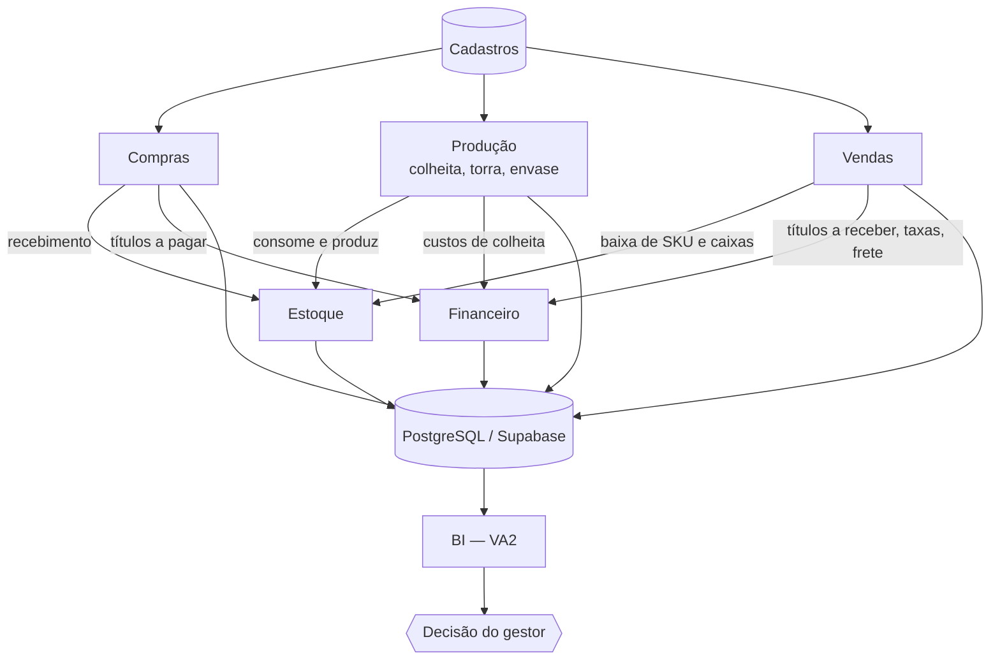

---

## 3. Módulos

O menu é montado conforme o papel do usuário. Cada papel vê apenas as páginas e as ações que pode usar.

| Módulo | Páginas | Papel no negócio |
|---|---|---|
| **Início** | Início | Vendas de hoje e do mês, títulos vencidos e a vencer, alertas de estoque mínimo e de frescor, atalhos do papel |
| **Vendas** | Vendas | Orçamento, confirmação (faturamento), expedição, entrega, cancelamento, comprovante em PDF, linha do tempo e margem por pedido |
| **Compras** | Compras | Pedido com itens e parcelas, recebimento com rateio de frete, cancelamento, estorno e pedido em PDF |
| **Produção** | Colheitas, Torras, Envases | Entrada de café da fazenda própria com custo; torra com quebra e custo do kg; envase com custo do pacote, validade e lote compatível |
| **Estoque** | Posição de estoque, Extrato | Saldos por categoria com custo médio e valor; extrato de movimentos por item; ajuste de inventário |
| **Financeiro** | Contas a pagar e a receber, Fluxo de caixa, Conciliação, Resultado (DRE) | Títulos, despesas manuais, liquidação em lote, fluxo realizado e previsto, conciliação por conta e DRE por competência |
| **Cadastros** | Produtos, Cafés verdes, Fazendas, Embalagens, Clientes, Fornecedores, Categorias e contas | Listar, criar, editar, inativar e excluir, com bloqueio quando o registro já é usado |
| **Administração** | Usuários, Parâmetros, Painel de integridade | Papéis e acesso; parâmetros com validação e auditoria; verificações de consistência |

### 3.1 Telas

**Página inicial** — cartões e alertas do dia.

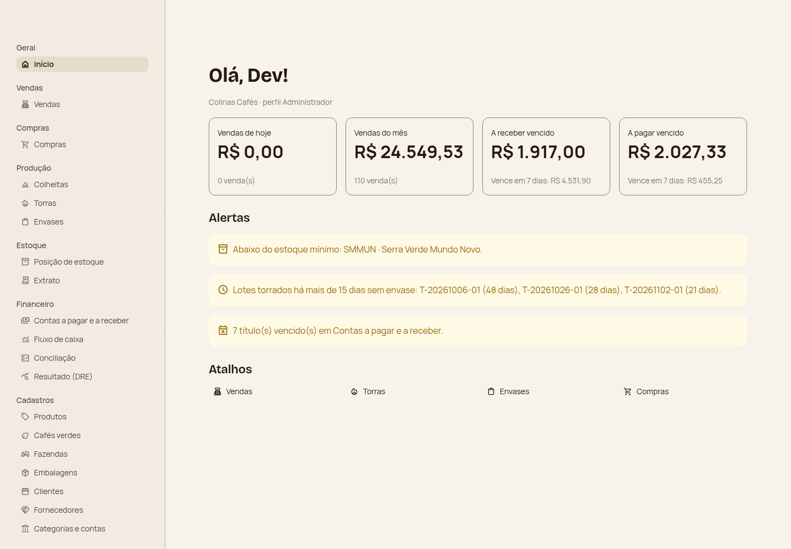

**Nova venda** — o preço vem da tabela do canal; a tela mostra em tempo real a disponibilidade, o total, o peso, as caixas e a taxa do cartão.

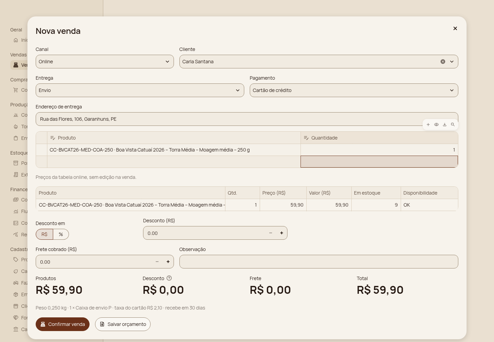

**Compras** — detalhe do pedido com itens, frete rateado, títulos e movimentos gerados.

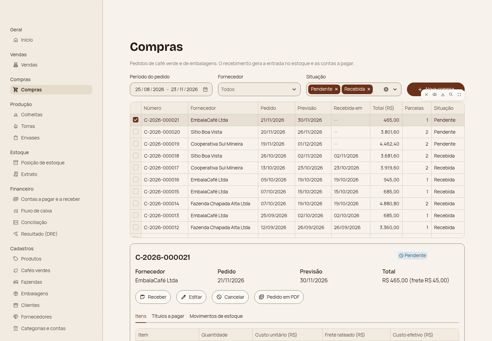

**Torras** — lote com quebra, custo do kg torrado, envases e movimentos.

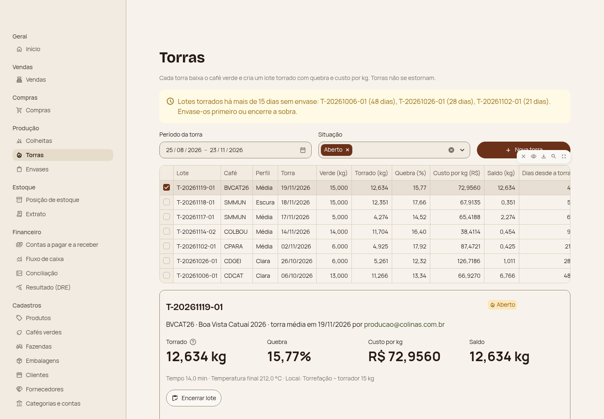

**Envases** — custo do pacote (café + pacote + etiqueta), validade e dias desde a torra.

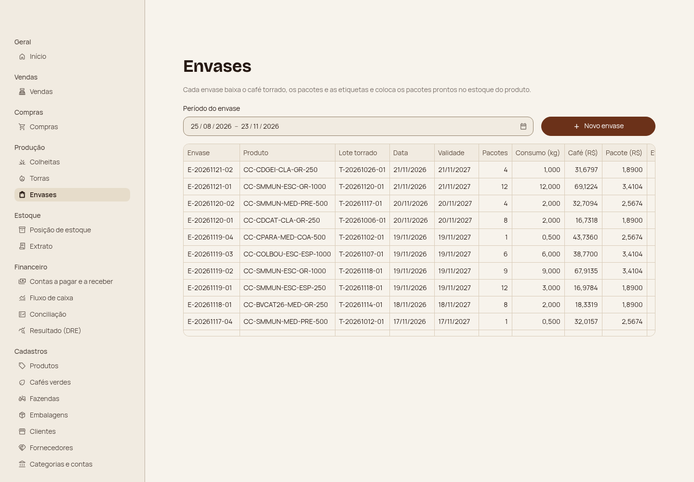

**Posição de estoque** e **extrato** de um produto.

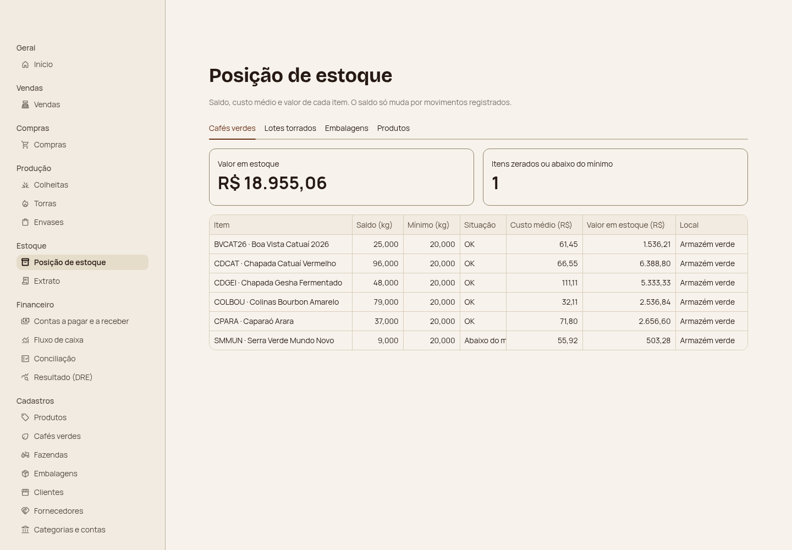

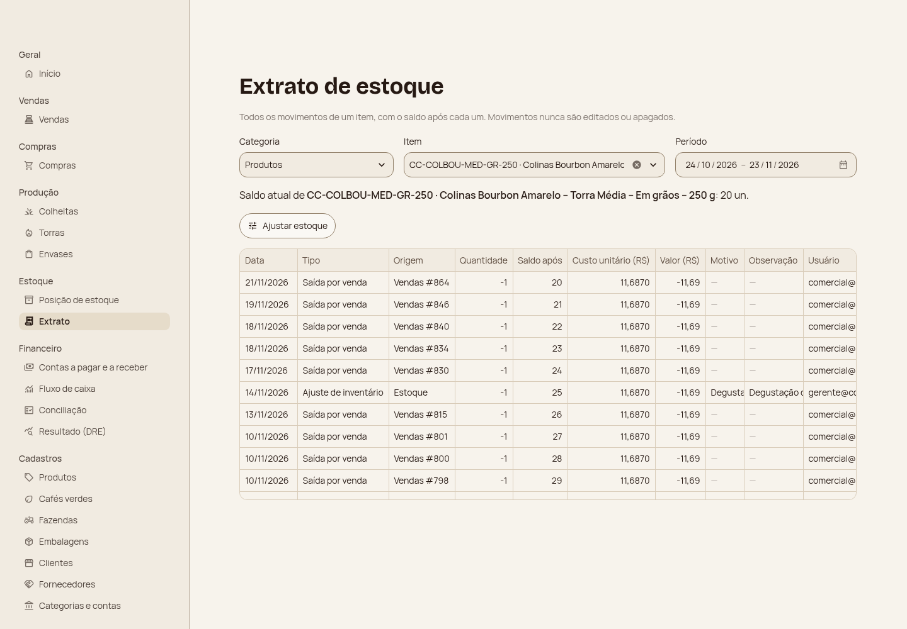

**Contas a pagar e a receber**, **fluxo de caixa**, **conciliação** e **DRE**.

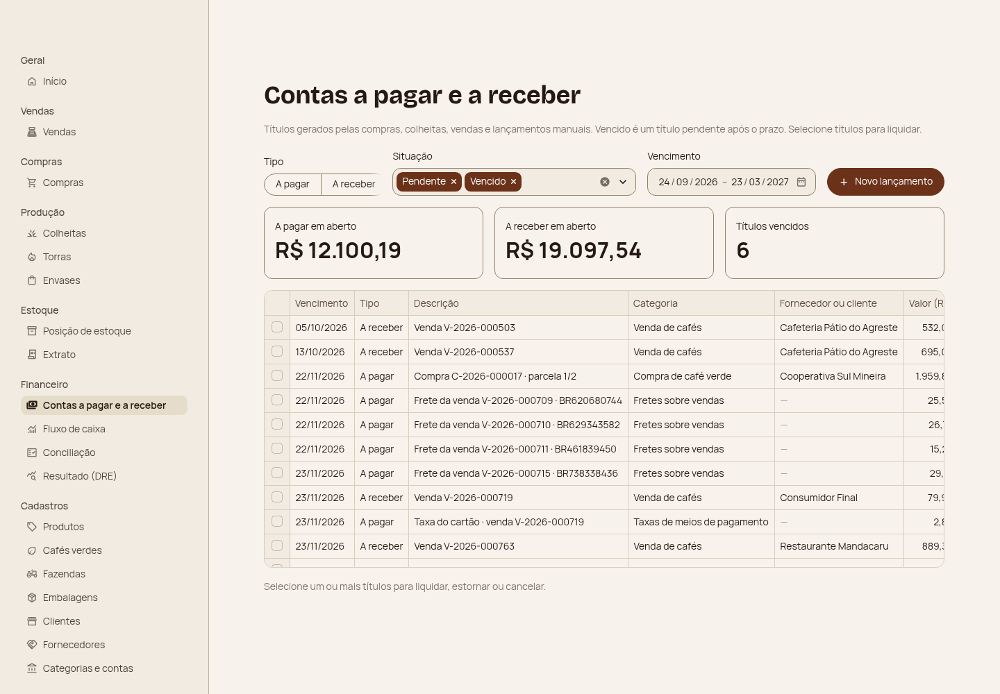

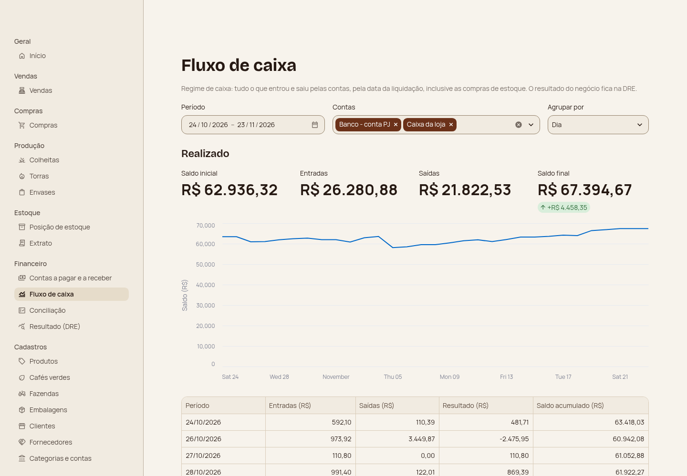

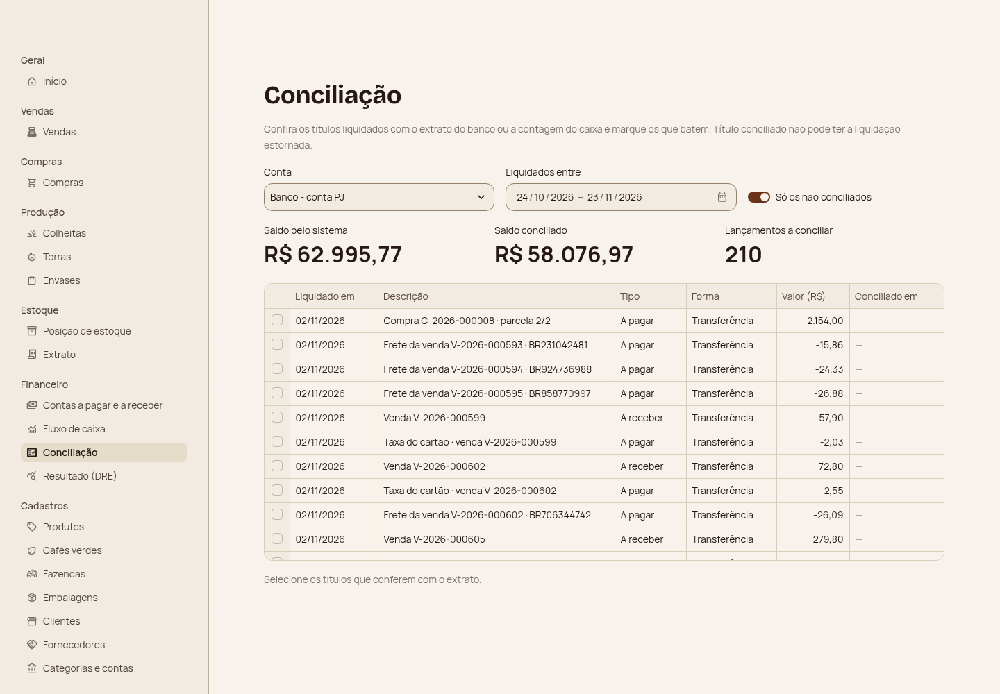

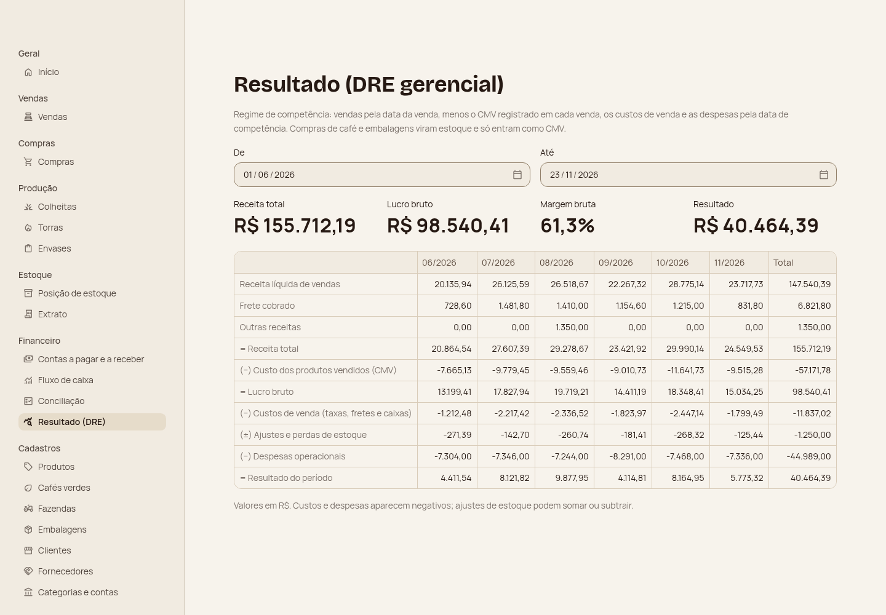

**Cadastro de produtos** e **parâmetros**.

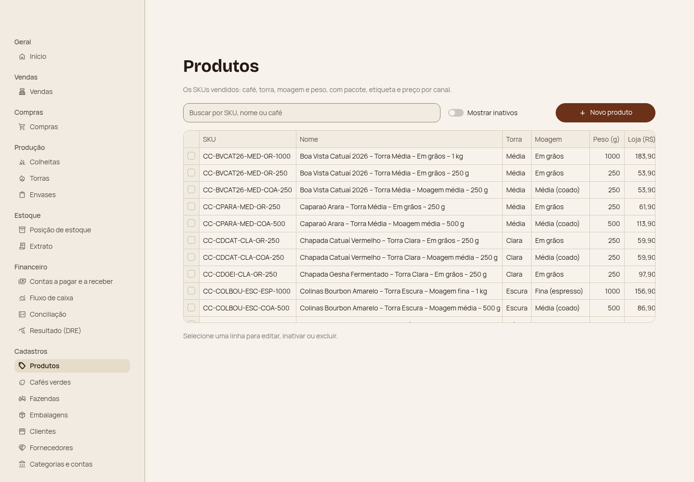

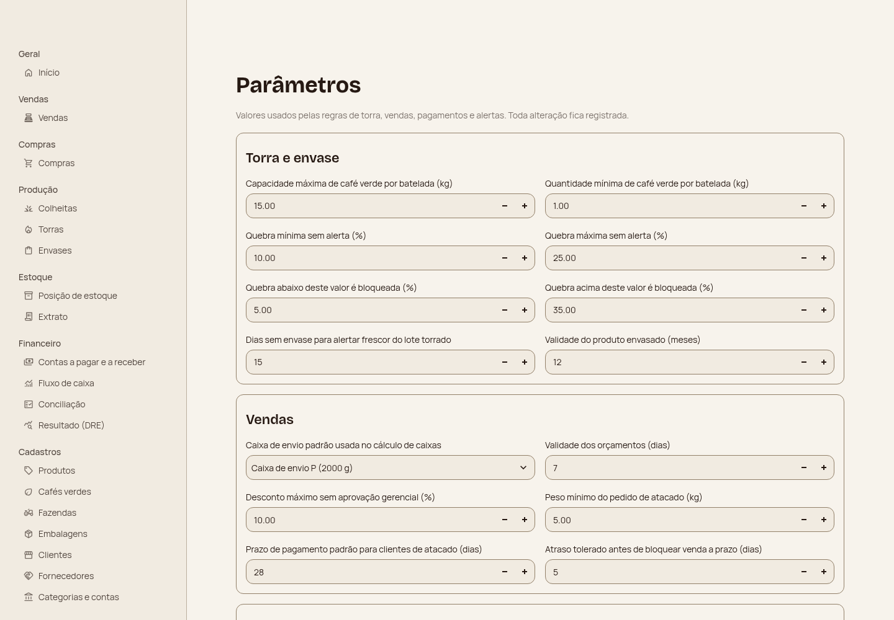

---

## 4. Modelo de dados

### 4.1 MER (entidades principais)

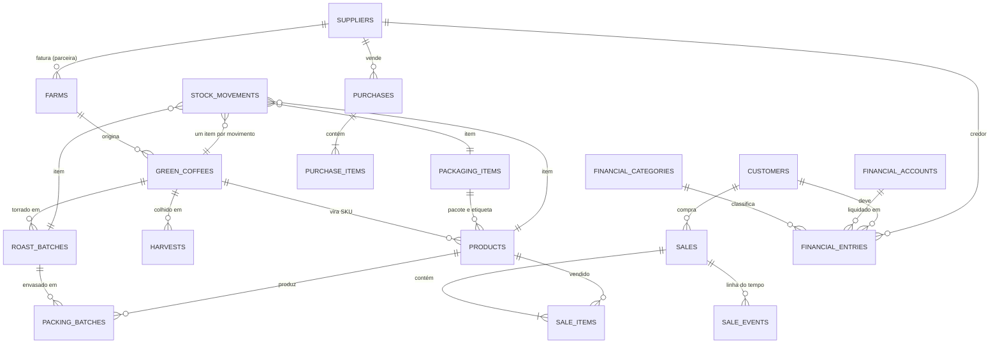

As tabelas e colunas usam nomes em inglês; a interface usa português. O esquema completo está em `sql/001_schema.sql`.

### 4.2 Decisões de modelagem

- **Saldo em cache + livro de movimentos imutável.** Cada item de estoque (café verde, lote torrado, embalagem e SKU) guarda o saldo e o custo médio para leitura rápida, e toda mudança gera uma linha em `stock_movements` com o saldo após o movimento. O saldo só muda por uma única função (RN-02), e o painel de integridade confere que saldo = soma dos movimentos.
- **Movimento com exatamente um item.** `stock_movements` tem quatro chaves estrangeiras opcionais e um `CHECK` que exige exatamente uma preenchida, além de sinal coerente com o tipo (entrada positiva, saída negativa).
- **Origem polimórfica.** Movimentos e títulos registram `source_module` e `source_id` (compra, produção ou venda). Assim, o detalhe de uma compra ou venda mostra todos os efeitos que ela gerou.
- **Snapshots para preservar a história.** Na confirmação, cada item de venda grava o preço e o custo médio do SKU naquele instante (`unit_cost_snapshot`), e a venda grava o custo dos produtos, das caixas e a taxa de pagamento. Margens antigas não mudam quando custos e preços mudam — base do BI.
- **Datas de negócio separadas da data do sistema.** Toda operação tem a data de competência (venda, torra, recebimento, liquidação) e o `created_at`. Só o administrador informa data retroativa.
- **Cadastros nunca somem.** Chaves estrangeiras `RESTRICT` impedem excluir o que já foi usado; o registro é inativado. Documentos finalizados não são editados: são cancelados ou estornados.
- **Restrições no banco.** `CHECK` de saldo não negativo, quebra coerente (0 < torrado < verde), combinações válidas de canal × entrega × pagamento, unicidade de SKU (café + torra + moagem + peso) e de CPF/CNPJ.

---

## 5. Integração entre módulos

### 5.1 Matriz de efeitos

| Operação | Estoque | Financeiro | Outros registros |
|---|---|---|---|
| Receber compra | Entrada por compra, custo médio recalculado com frete rateado | N títulos a pagar (parcelas) | Status, custo efetivo por item |
| Estornar compra | Estorno com custo médio reverso | Títulos cancelados | Status estornado |
| Colheita | Entrada de café verde com custo | 1 título a pagar | Colheita |
| Torra | Saída de verde, entrada do lote torrado | — (custo fica no estoque) | Lote de torra |
| Envase | Saídas de lote, pacote e etiqueta; entrada do SKU com custo médio | — | Lote de envase; encerra o lote torrado que zera |
| Confirmar venda | Saída de SKUs e caixas de envio | A receber (já liquidado em PIX e dinheiro) + taxa de cartão | Snapshots de custo, evento |
| Expedir | — | A pagar do frete real | Rastreio, evento |
| Cancelar venda confirmada | Estorno de SKUs e caixas pelo custo da venda | A receber e taxa cancelados, ou reembolso se já recebido | Evento com motivo |
| Ajuste de inventário | Ajuste com motivo | — (a perda aparece na DRE) | Observação obrigatória |
| Lançar despesa, liquidar, conciliar | — | Título, liquidação e conciliação | — |

Toda operação integrada roda em **uma única transação**: se qualquer etapa falhar, nada é gravado (RN-17). Os testes de integração provocam falhas de propósito e conferem que nenhuma tabela mudou.

### 5.2 Sequência da confirmação de venda

```mermaid
sequenceDiagram
    participant UI as Página Vendas
    participant S as services.sales
    participant D as domain
    participant I as services.inventory
    participant F as repositories.finance
    participant DB as PostgreSQL
    UI->>S: confirm_sale(venda, usuário)
    S->>S: ensure_permission(MANAGE_SALES)
    S->>DB: BEGIN; SELECT venda FOR UPDATE
    S->>D: ensure_transition(orçamento → confirmada); validate_sale (RN-13, RN-19)
    S->>D: ensure_credit_available (RN-20, boleto)
    loop cada item
        S->>I: record_movement(saída de venda) — trava o SKU, valida saldo (RN-01)
        S->>DB: grava custo do item no momento da venda (RN-14)
    end
    S->>I: record_movement(saída de caixas, RN-15)
    S->>F: título a receber (+ taxa do cartão, RN-16)
    S->>DB: status, custos, evento; COMMIT (ou ROLLBACK)
    S-->>UI: efeitos (estoque, financeiro, margem)
```

### 5.3 Cartão de efeitos

Depois de cada operação integrada, a página mostra um cartão com o que mudou em cada módulo — a prova visual da integração.

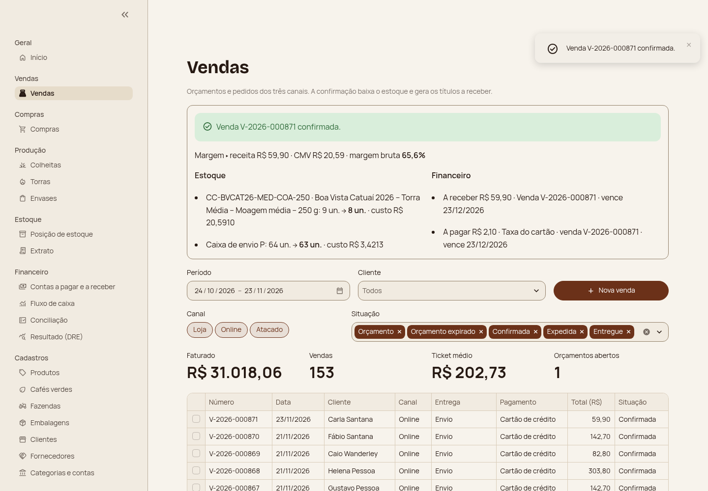

---

## 6. Regras de negócio

A coluna **Onde** indica a camada que garante a regra: **U** interface, **S** serviço (regra oficial), **B** banco (última barreira).

| ID | Regra | Justificativa e contexto | Onde |
|---|---|---|---|
| RN-01 | Nenhuma operação deixa saldo negativo; a mensagem informa item, disponível e solicitado | Não se torra café que não existe nem se vende pacote que não está na prateleira | U, S, B |
| RN-02 | Saldo e custo médio só mudam por `services.inventory.record_movement`, que trava o item e grava o movimento com saldo após | Garante saldo = Σ movimentos e histórico de todo saldo | S, painel |
| RN-03 | Cada movimento afeta um item, com sinal coerente com o tipo; embalagens e SKUs só em unidades inteiras | Integridade do livro de estoque | B |
| RN-04 | Custo médio ponderado recalculado nas entradas com custo; estorno de compra usa a fórmula reversa | Reflete a variação do preço do café entre safras | S |
| RN-05 | Frete da compra rateado pelo valor dos itens e somado ao custo | O custo do grão posto na torrefação inclui o transporte | S |
| RN-06 | Peso verde por torra entre 1 kg e a capacidade do torrador (15 kg) | Limite físico do equipamento | U, S |
| RN-07 | 0 < peso torrado < peso verde | A torra sempre perde massa | U, S, B |
| RN-08 | Quebra fora de 10–25% exige confirmação; fora de 5–35% é bloqueada | Evita erro de digitação sem impedir torras atípicas reais | U, S |
| RN-09 | Custo do kg torrado = peso verde × custo médio ÷ peso torrado | A quebra encarece o kg torrado | S |
| RN-10 | O SKU usa pacote com capacidade igual ao seu peso e uma etiqueta; café + torra + moagem + peso é único | Impede "1 kg" em pacote de 250 g e SKUs duplicados | U, S, B |
| RN-11 | Envase só de lote aberto do mesmo café e perfil do SKU, com lote, pacote e etiqueta suficientes | O que está no rótulo é o que está dentro | U, S |
| RN-12 | Custo do pacote = peso × custo do kg do lote + custo do pacote + custo da etiqueta | Custo real por pacote, a principal dor da empresa | S |
| RN-13 | Preço vem do cadastro conforme o canal; atacado exige PJ não consumidor, preço de atacado e peso mínimo | Política comercial por canal | U, S, B |
| RN-14 | Na confirmação, gravam-se preço e custo médio do SKU de cada item, custo das caixas e taxa | Preserva a margem histórica para o BI | S |
| RN-15 | Envio consome ⌈peso ÷ capacidade da caixa padrão⌉ caixas; retirada e entrega local não | Generaliza o "1 caixa por pedido", que falhava em pedidos grandes | S |
| RN-16 | PIX e dinheiro nascem liquidados; cartões geram recebível com prazo e título da taxa; boleto vence no prazo do cliente | Reflete o fluxo de caixa real e o custo dos meios de pagamento | S |
| RN-17 | Cada operação integrada roda em uma única transação | Evita estados impossíveis, como venda sem baixa de estoque | S |
| RN-18 | Documentos finalizados não são editados nem excluídos; correção por cancelamento ou estorno | Não sobrescrever registros; trilha de auditoria | S |
| RN-19 | Desconto ≤ produtos; total > 0; desconto acima de 10% só com gerente | Controle de margem e de alçada | U, S, B |
| RN-20 | Boleto só para cliente sem atraso acima da tolerância e dentro do limite de crédito | Controle de risco do B2B | S |
| RN-21 | Cadastros usados não são excluídos, só inativados; inativos não aparecem em novas operações | "Remoção" sem quebrar o histórico | S, B |
| RN-22 | Liquidação só de título pendente, com data entre a competência e hoje e conta ativa; estorno só se não conciliado | Coerência do caixa e da conciliação | S, B |
| RN-23 | Transições de status seguem os diagramas de compra, venda e título | Ciclo de vida previsível | S |
| RN-24 | Competência = hoje; só o administrador informa data retroativa (até 365 dias), nunca futura | Impede manipulação de período | U, S |
| RN-25 | Orçamento vencido só é confirmado depois de atualizar os preços | Preço e disponibilidade podem ter mudado | S |
| RN-26 | Colheita só para café de fazenda própria; compra de café só de fazenda parceira do fornecedor | Coerência entre origem física e financeira | U, S |
| RN-27 | Expedição exige rastreio e custo real do frete ≥ 0 | Rastreabilidade logística e frete subsidiado | U, S |
| RN-28 | CPF e CNPJ validados pelo dígito verificador e únicos | Qualidade cadastral | U, S, B |
| RN-29 | Categorias e contas do sistema não podem ser excluídas; não se remove o último administrador | Integrações dependem delas | S |

---

## 7. Arquitetura

### 7.1 Stack

| Camada | Tecnologia |
|---|---|
| Interface e aplicação | Python 3.12, Streamlit 1.67 (autenticação OIDC nativa com Google) |
| Acesso a dados | psycopg 3 e psycopg-pool, SQL parametrizado, transações explícitas |
| Banco | PostgreSQL 16 (Supabase em produção, contêiner local no desenvolvimento) |
| Documentos | fpdf2 (comprovante de venda e pedido de compra em PDF) |
| Publicação | Streamlit Community Cloud, publicação contínua a partir da branch `main` |
| Qualidade | pytest (testes unitários e de integração em PostgreSQL real), ruff |

### 7.2 Camadas

```
ui/  ──►  services/  ──►  domain/          (regras e cálculos puros)
                     └─►  repositories/  ──►  PostgreSQL
```

- **`ui/`**: páginas Streamlit. Não contém SQL nem regra de negócio.
- **`services/`**: casos de uso. Verificam a permissão, abrem **a** transação e orquestram domínio e repositórios.
- **`domain/`**: entidades, regras e cálculos sem banco e sem Streamlit, testados isoladamente.
- **`repositories/`**: SQL parametrizado; recebem a conexão e nunca fazem *commit*.
- **`core/`**: configuração, conexão, transação, relógio de negócio e erros.

### 7.3 Decisões e justificativas

| Decisão | Alternativa descartada | Justificativa |
|---|---|---|
| Camadas UI → services → domain/repositories | Lógica nas páginas | Separação de responsabilidades; regras testáveis sem interface; o *seed* reutiliza os mesmos serviços |
| SQL parametrizado com psycopg | ORM | Modelo relacional e transações explícitos, que é o que a disciplina avalia |
| Uma transação por operação integrada | *Commits* por tabela | Atomicidade (RN-17) |
| Saldo em cache + livro de movimentos | Somar movimentos a cada leitura | Leitura rápida; consistência garantida por caminho único de escrita, CHECK e painel de integridade |
| Autorização no banco + autenticação Google | Só Google | O Google identifica a pessoa; o ERP decide o que ela pode fazer |
| `st.navigation` montado por papel | Pasta `pages/` automática | Menu dinâmico com seções nomeadas |

### 7.4 Segurança

- **Login Google (OIDC)** pelo recurso nativo do Streamlit. E-mails desconhecidos entram como **Visitante** (somente leitura); o administrador define o papel na página Usuários.
- **Papéis:** Administrador, Gerente, Produção, Comercial, Financeiro e Visitante. A permissão é verificada em duas camadas: o menu só mostra as páginas permitidas, e **todo serviço de escrita** chama `ensure_permission` antes de abrir a transação.
- **Banco:** Row Level Security habilitado em todas as tabelas, sem políticas de acesso público; assim, nada fica exposto pela API pública do Supabase. A aplicação conecta pelo *pooler* com o usuário do banco, guardado nos *secrets*.
- **Segredos:** `secrets.toml` fora do Git; no Streamlit Cloud as credenciais ficam no painel de *secrets*.
- **Rastreabilidade:** toda tabela transacional grava `user_email` e `created_at`; cadastros gravam `updated_at` e `updated_by`; mudanças de parâmetros vão para `audit_log`.

### 7.5 Estrutura de pastas

```
app.py                  # página, login e navegação por papel
core/                   # configuração, banco, transação, relógio de negócio, erros
domain/                 # regras: estoque, compras, produção, vendas, financeiro, parâmetros
repositories/           # SQL por agregado
services/               # casos de uso transacionais
ui/pages/               # uma página por módulo
sql/                    # migrações versionadas (001_schema.sql, 002_reference_data.sql, ...)
scripts/migrate.py      # aplica migrações
scripts/seed/           # gerador do histórico de desenvolvimento
tests/unit, tests/integration
```

---

## 8. Validação

### 8.1 Roteiro de demonstração

O roteiro de 14 passos da especificação está automatizado em `tests/integration/test_demo_script.py`, que executa todos os passos em sequência no mesmo banco e confere os valores esperados:

| # | Passo | Resultado conferido |
|---|---|---|
| 1 | Papéis | Gerente executa; Visitante não vê ações de escrita |
| 2 | Cadastros | SKU com pacote de 500 g para 250 g bloqueado (RN-10) |
| 3 | Compras recebidas | Verde 30 kg a R$ 60,00; pacotes 100; títulos de R$ 900 + R$ 900 + R$ 375 |
| 4 | Torra 10 → 8,4 kg | Quebra 16,00%, custo R$ 71,4286/kg; 18 kg e quebra de 40% bloqueados |
| 5 | Envase de 20 pacotes | Lote 3,400 kg; pacotes 80; custo do pacote R$ 20,0071 |
| 6 | Venda online | Total R$ 127,80; taxa R$ 4,47; CMV R$ 40,01; margem 63,6%; caixa 50 → 49 |
| 7 | Expedição e entrega | Frete de R$ 22,00; linha do tempo Orçamento → Confirmada → Expedida → Entregue |
| 8 | Venda de balcão em PIX | Recebível já liquidado; nenhuma caixa consumida |
| 9 | Vender 30 pacotes | "Estoque insuficiente … tem 17 un." e nada gravado |
| 10 | Despesa e liquidações | Entradas R$ 177,70; saídas R$ 904,47; resultado de caixa −R$ 726,77 |
| 11 | Conciliação | Saldo conciliado = saldo do sistema |
| 12 | Degustação | SKU 17 → 16 |
| 13 | Painel de integridade | Todas as verificações sem divergência |
| 14 | Cancelamento de venda no cartão | SKU volta; recebível e taxa cancelados |

### 8.2 Painel de integridade

Nove verificações em SQL que devem retornar zero divergências: saldo = Σ movimentos (I1); saldo após o último movimento = saldo atual (I2); venda faturada tem título a receber com o valor total (I3); baixa de estoque de cada venda = soma dos itens (I4); compra recebida tem títulos com valor e parcelas corretos (I5); itens faturados têm custo registrado (I6); lotes encerrados zerados e lotes zerados encerrados (I7); todo título de operação aponta para um documento existente (I8); valor das entradas de envase = valor dos lotes de envase (I9). Depois do histórico completo de seis meses, as nove passam.

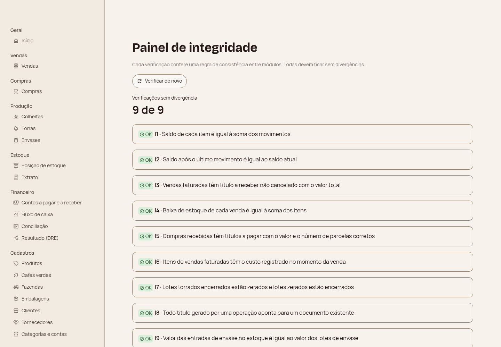

### 8.3 Testes automatizados

- **337 testes** (unitários e de integração), executados em PostgreSQL real; a suíte recria o esquema e restaura os dados de referência a cada teste.
- **Unitários:** todos os cálculos da especificação (quebra, custo do kg torrado, custo médio, rateio de frete, custo do pacote, caixas, taxa, margens), validação de CPF/CNPJ, faixas de quebra, combinações de canal, transições de status, fluxo de caixa e DRE.
- **Integração:** cada operação integrada tem um teste dos efeitos em todos os módulos e um teste de *rollback* completo em caso de falha; permissões por papel; o roteiro completo; o *seed* reduzido com o painel de integridade.

---

## 9. Dados para a VA2

### 9.1 Estratégia

O histórico de desenvolvimento é gerado por `python -m scripts.seed --profile full`, que:

- **usa a camada de serviço**: o *seed* chama as mesmas funções que as páginas usam, com usuários de cada papel (gerente, produção, comercial e financeiro). Todas as regras, integrações e validações valem, e o painel de integridade fica 100% ao final;
- **simula dia a dia**, de 1º de junho de 2026 até a véspera da execução: despesas fixas mensais, reposição de compras pelo ponto de pedido, colheitas, torras e envases conforme a cobertura de estoque, vendas nos três canais com sazonalidade, expedições, entregas, liquidações, degustações, inventários e conciliação mensal;
- **é determinístico** (semente fixa) e **protege bancos reais**: só roda em bancos terminados em `_dev` ou `_test` (ou com `--allow-production`) e recusa bancos que já têm vendas;
- tem um perfil **reduzido** (`--profile small`, 14 dias) usado pelos testes.

Para que as datas internas de todas as operações sigam o dia simulado — inclusive as calculadas pelo próprio sistema, como o vencimento do frete na expedição —, o *seed* fixa o **dia de negócio** do relógio do sistema (`core.clock.business_day`). Na aplicação, o relógio é sempre a data real.

### 9.2 Volumes gerados

| Entidade | Volume |
|---|---|
| Fazendas / cafés verdes | 5 / 7 (1 própria + 4 parceiras; duas safras da Boa Vista) |
| Produtos (SKUs) | 19 cadastrados, 16 ativos (a safra 2025 sai do catálogo quando esgota) |
| Clientes | 65 pessoas físicas, 11 empresas |
| Compras / colheitas | 21 / 3 |
| Torras / envases | 101 / 263 |
| Vendas | 869 (loja 50%, online 43%, atacado 7% dos pedidos; atacado 47% dos kg) |
| Títulos financeiros | 1.688 |
| Movimentos de estoque | 3.009 |

### 9.3 Comportamentos embutidos para a análise

O histórico reproduz de propósito alguns padrões de negócio, para que o BI da VA2 os descubra pelos indicadores:

| # | Comportamento |
|---|---|
| C1 | Sazonalidade: meses frios mais fortes, alta do online antes do Dia dos Pais e na semana que antecede a Black Friday |
| C2 | Safra 2026 de café verde ~18% mais cara; preços de venda reajustados só no fim de outubro, com queda da margem bruta em agosto–outubro |
| C3 | Quebra anômala no café Caparaó (umidade de 13,5%), cerca de 3 p.p. acima dos demais no perfil médio |
| C4 | Ruptura do pacote de 250 g em outubro (compra atrasada), com envases interrompidos por cerca de 10 dias |
| C5 | Crescimento do online com frete subsidiado em cerca de metade dos envios |
| C6 | Inadimplência de uma cafeteria: dois boletos vencidos há mais de 30 dias e novas vendas a prazo bloqueadas |
| C7 | Concentração do atacado: os dois maiores clientes respondem por mais da metade dos kg |
| C8 | Lotes torrados que ficam mais de 15 dias sem envase em meses fracos |

### 9.4 Campos que habilitam a análise

- `sales.sale_date`, `channel`, `delivery_type`, `payment_method`, `products_cost`, `boxes_cost`, `payment_fee`, `actual_freight_cost` e `sale_items.unit_cost_snapshot`: receita, CMV e margens por canal, produto e período sem recalcular o passado;
- `roast_batches.weight_loss_pct`, `cost_per_kg` e `packing_batches.days_since_roast`, `unit_cost`: quebra, custo e frescor;
- `stock_movements` com tipo, motivo e saldo após: giro, rupturas e perdas;
- `financial_entries` com categoria e grupo da DRE, competência, vencimento, liquidação e conciliação: fluxo de caixa, inadimplência e resultado.

---

## 10. Limitações declaradas

- A venda baixa o saldo agregado do SKU, sem lote de envase; a rastreabilidade vai até o envase.
- Liquidação apenas integral, sem pagamento parcial.
- Custos indiretos de produção (gás, energia, mão de obra) são despesas do período e não entram no custo do pacote (custeio variável), evitando dupla contagem.
- Comprovante não fiscal; sem integração bancária; conciliação manual.
